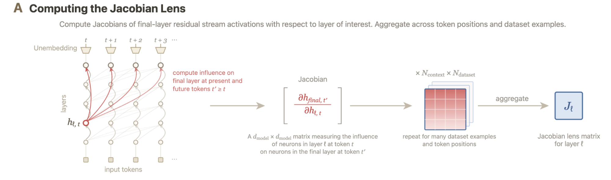
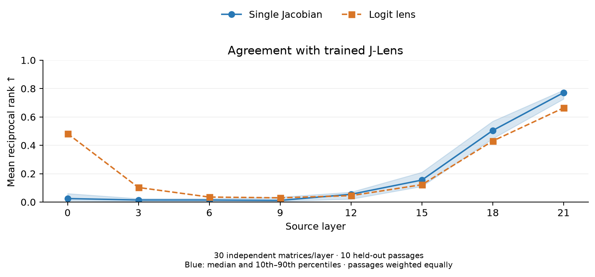
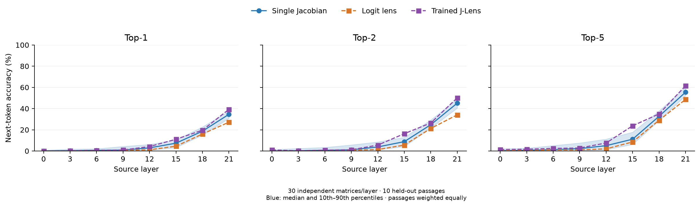

# My Attempt to Explain Jacobian Lens

## 1. What is a Jacobian Lens?

[Anthropic’s Jacobian Lens (J-Lens)](https://transformer-circuits.pub/2026/workspace/index.html) reads intermediate activations as vocabulary scores. Its readouts can reveal concepts involved in intermediate computation, including information the model does not immediately output.

Panel A below, from [2.1 The Jacobian Lens](https://transformer-circuits.pub/2026/workspace/index.html#methods-jlens), illustrates the starting point: measure how a small change at an intermediate activation affects final-layer activations at the current and future token positions.

For source position \(t\) and target position \(t'\), that relationship is a Jacobian:

\[
J_{\ell,t',t}=\frac{\partial h_{L,t'}}{\partial h_{\ell,t}}.
\]

J-Lens aggregates these Jacobians across token positions, optionally across multiple prompts, to obtain one matrix \(\bar J_\ell\) per layer.

To inspect an activation:

\[
\operatorname{lens}(h)=\operatorname{softmax}\!\left(W_U\operatorname{norm}(\bar J_\ell h)\right).
\]

The highest-scoring tokens suggest concepts represented in the intermediate activation.

## 2. Averaging is useful, but not the entire story

[A Mathematical Theory of the Jacobian Lens](https://arxiv.org/abs/2610.31955) explains what survives Jacobian averaging: responses that are strong and consistently oriented across token lags and contexts. Responses that disagree can cancel.

That helps explain the selection made by averaging Jacobian across token positions and contexts. But another question comes first: why can a Jacobian measured in one situation decode an activation from another situation at all?

Even a single same-position Jacobian seems to contain some reusable transport structure.

## 3. A single Jacobian matrix is already amazing

### 3.1 A tiny experiment

We computed individual same-position Jacobians in Qwen3.5-2B and applied each as a lens to unrelated passages. We tested 30 matrices at each of eight layers, using ten held-out passages. No Jacobians were averaged.

At each evaluation position, a [trained J-Lens](https://huggingface.co/datasets/sida/llmdbg/blob/980e34bc0f0460c437bb4fa0238a58b9b50158d3/workspace-lenses/v2/Qwen--Qwen3.5-2B/j/lens.safetensors) supplied a reference token. We measured where the single-Jacobian lens and logit lens ranked that token. At tested layers 12 and later, the median single-Jacobian readout outperformed the logit lens. The benefit became more consistent at later layers.

For a concrete layer-21 example, the measurement passage included:

> Inside, a curator carefully arranged pottery, maps, and ancient tools in **glass** cases.

The single Jacobian was measured at “ glass,” position 23 in the full passage, from its layer-21 activation to its final-layer activation at the same position:

\[
J=\frac{\partial h_{23,23}}{\partial h_{21,23}}.
\]

The unrelated evaluation passage described making soup:

> Taste before adding salt, and finish with **fresh** herbs just before serving the meal.

At “ fresh,” position 39 in the full evaluation passage, the three readouts were:

| Readout | Top six tokens, in order |
|---|---|
| Trained J-Lens | herbs, parsley, basil, lemon, peas, greens |
| Single Jacobian | herbs, parsley, lemon, basil, peas, spinach |
| Logit lens | corri, bas, cor, basil, бази, herbs |

The trained lens’s top token, “ herbs,” ranks first with the single Jacobian and sixth with the logit lens. Reciprocal rank is simply \(1/\text{rank}\), giving scores of 1 and approximately 0.17. The plot summarizes comparisons like this across evaluation positions and passages; the blue line is the median score across 30 individual Jacobians, with shading showing their 10th–90th percentiles. Passages are weighted equally.

A same-position Jacobian measures effects on the final activation used for the next-token prediction. We therefore expect its readout to emphasize information relevant to that prediction. Standard J-Lens also includes effects at future positions, allowing it to reveal concepts available for later use, alongside next-token predictions.

The previous experiment measures agreement with the trained J-Lens. If we directly measure next-token prediction accuracy, here is the result:

This experiment suggests that useful transport structure already exists in individual Jacobians, before averaging.

### 3.2 How one matrix connects meaningful directions

The Linear Representation Hypothesis suggests that some concepts can be represented by directions: adding a concept vector to an activation can strengthen that concept.

A single Jacobian describes the local response to a small addition along any direction. Writing \(J\) for one individual Jacobian, with its layer and position indices omitted:

\[
h\rightarrow h+\epsilon v
\quad\Rightarrow\quad
\delta h_L\approx\epsilon Jv.
\]

For any direction \(v\), including concept directions described by the Linear Representation Hypothesis, the Jacobian describes how a small addition along \(v\) affects the final activation.

Consider the token “ meaning.” The model assigns it a score by comparing the final activation with its unembedding vector \(w\). This gives us a direction at the output associated with that token.

The predicted change \(\epsilon Jv\) can be compared with this output direction. A positive projection increases the token’s score, ignoring final normalization:

\[
\delta\operatorname{logit}_{\text{meaning}}
\approx\epsilon w^\top Jv.
\]

The same expression can be written as \(\epsilon(J^\top w)^\top v\). The vector \(J^\top w\) identifies the intermediate-layer direction whose addition most strongly increases the “ meaning” score for a fixed small perturbation size, under this approximation.

The amazing part is that this one single Jacobian matrix can do this for every vocabulary token: each unembedding vector supplies a label for one downstream effect.

The chain is: add an intermediate direction → change the final activation → change a token’s score. Token text gives us a convenient label for that effect.

## 4. Beyond a vocabulary lens

The Jacobian is not limited to token-labelled output directions. For any final-layer direction \(u\), including directions that do not correspond to individual vocabulary tokens, the corresponding intermediate sensitivity is \(J^\top u\).

We could choose \(u\) from a concept probe, a contrast between conditions, a learned feature, or a singular vector identifying a strong transport channel. Such directions need experiments to establish their meaning, but need not have a single-token name.

Tokens make the results readable. The Jacobian’s transport structure offers more to investigate than that vocabulary alone.
